# Modelo térmico de transformadores de potencia a partir de registros de operación

Código, datos y resultados del Trabajo Fin de Máster *Análisis de datos
operativos para optimizar mantenimiento predictivo en subestaciones de
Manabí*.

Ricardo Eduardo Cleri Bravo\
Máster Universitario en Ingeniería Matemática y Computación\
Universidad Internacional de La Rioja, 2026

---

## Pregunta

Los transformadores de potencia de una subestación se vigilan con rutinas
manuales que dejan, cada día, un registro de la temperatura del aceite, la
carga y la temperatura ambiente. El trabajo examina si esos registros bastan
para identificar los parámetros del modelo térmico de la norma IEEE C57.91,
y qué condiciones debe cumplir el registro para que la identificación sea
posible.

Se analizan veintitrés meses de registros de dos subestaciones, `S1` y `S2`,
y tres transformadores: `T1` y `T2` en S1, y el autotransformador `T3` en S2.

## Modelo

La norma IEEE C57.91 relaciona en régimen permanente la temperatura del aceite
en la parte superior de la cuba con la carga y el ambiente:

$$
\theta_{aceite} = \theta_{amb} + \Delta\theta_R \left[ \frac{K^2 R + 1}{R + 1} \right]^n,
\qquad K = \frac{S}{S_R}
$$

| Símbolo | Significado | Tratamiento |
|---|---|---|
| $S$ | carga del día | dato, en por unidad de la placa |
| $S_R$ | potencia nominal | fijada en la placa o estimada |
| $\Delta\theta_R$ | calentamiento del aceite sobre el ambiente a plena carga | estimado |
| $R$ | relación entre pérdidas en carga y en vacío | fijo, 3,2 |
| $n$ | exponente de refrigeración | fijo, 0,8 |

$R$ y $n$ se mantienen en sus valores normativos para refrigeración por aire
forzado: el objetivo es contrastar el modelo tal como la norma lo prescribe,
no el que mejor se adapte a estos datos.

Fijada $S_R$, el modelo es lineal en $\Delta\theta_R$, que tiene solución
exacta por mínimos cuadrados. La búsqueda se reduce así a una dimensión,
$S_R$, que se recorre en una rejilla de 271 valores entre 0,30 y 3,00 veces
la placa.

## Datos

`datos/T1.csv`, `datos/T2.csv` y `datos/T3.csv` contienen un registro diario
por transformador: temperatura del aceite y del bobinado, carga, temperatura
ambiente, gases disueltos cuando existen y estado del cambiador de tomas. El
diccionario de columnas está en el Anexo B de la memoria.
`datos/incidencias.json` recoge cuántos días se descartaron de cada máquina
y por qué motivo.

Los datos están anonimizados. Las instalaciones se designan `S1`, `S2`, `T1`,
`T2` y `T3`. Las fechas están desplazadas una cantidad fija que conserva los
intervalos entre registros, y las cargas se expresan en por unidad de la
placa de cada máquina, sin ninguna magnitud absoluta de potencia. Los
formularios de origen no se publican.

## Método

Para cada transformador:

1. **Ajuste con la placa fijada.** $S_R = 1$ y un único parámetro libre,
   $\Delta\theta_R$. Es el análisis principal.
2. **Ajuste libre.** $S_R$ y $\Delta\theta_R$ libres, para comprobar si los
   datos recuperan la potencia de placa.
3. **Intervalo de equivalencia.** Valores de $S_R$ cuyo error queda dentro de
   un 2 % del mínimo: los que explican los datos igual de bien.
4. **Comparación fuera de muestra** frente a dos modelos de contraste: un
   ajuste lineal de la elevación con la carga (dos parámetros, sin base
   física) y una elevación constante sobre el ambiente (un parámetro).
   Se usan dos esquemas: validación cruzada dejando fuera un mes completo cada
   vez, y validación temporal, ajustando en el primer periodo y midiendo en
   el segundo.
5. **Pendiente del residuo frente al ambiente**, como diagnóstico de la
   calidad del registro de temperatura ambiente.
6. **Envejecimiento equivalente del aislamiento**, con la expresión de
   Arrhenius de la norma.

Además resume los demás indicadores de condición que contienen los
registros: la diferencia entre el máximo diario y la lectura de ronda, el
gradiente entre bobinado y aceite, la deriva del residuo en el tiempo, el
ritmo del cambiador de tomas y los gases disueltos. Y comprueba
automáticamente la anonimización: cada valor de los archivos publicados, tanto
de los tres conjuntos como del registro de incidencias, debe ser una etiqueta
de equipo, un número, una fecha normalizada o un hueco.

La métrica es el error absoluto medio (MAE) en grados Celsius, porque las
lecturas están redondeadas al grado entero.

## Resultados

Cifras de la variante principal, con la temperatura máxima diaria del aceite.

### Identificación de los parámetros

| Transformador | Días | Recorrido de carga p10–p90 (pu) | Δθ_R con la placa (°C) | S_R libre (pu) | Intervalo de equivalencia (pu) | ¿Contiene la placa? | Pendiente del residuo |
|---|---|---|---|---|---|---|---|
| T1 | 178 | 0,17 | 54,2 | 3,00 | 1,95 – 3,00 | no | −1,04 |
| T2 | 167 | 0,16 | 48,1 | 2,61 | 1,65 – 3,00 | no | −0,96 |
| T3 | 251 | 0,25 | 26,5 | 0,86 | 0,51 – 1,25 | sí | +0,22 |

En T3 la potencia estimada libremente es compatible con la placa. En T1 y T2
el ajuste libre lleva $S_R$ a valores sin sentido físico, en T1 hasta el
borde de la rejilla: los datos no determinan el parámetro.

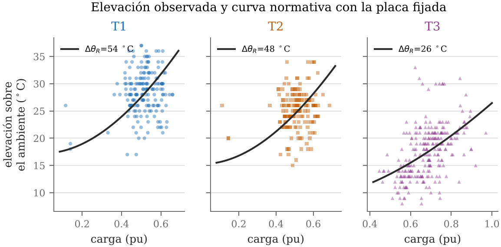

*Elevación del aceite sobre el ambiente frente a la carga, con la curva de la
norma ajustada con la placa fijada.*

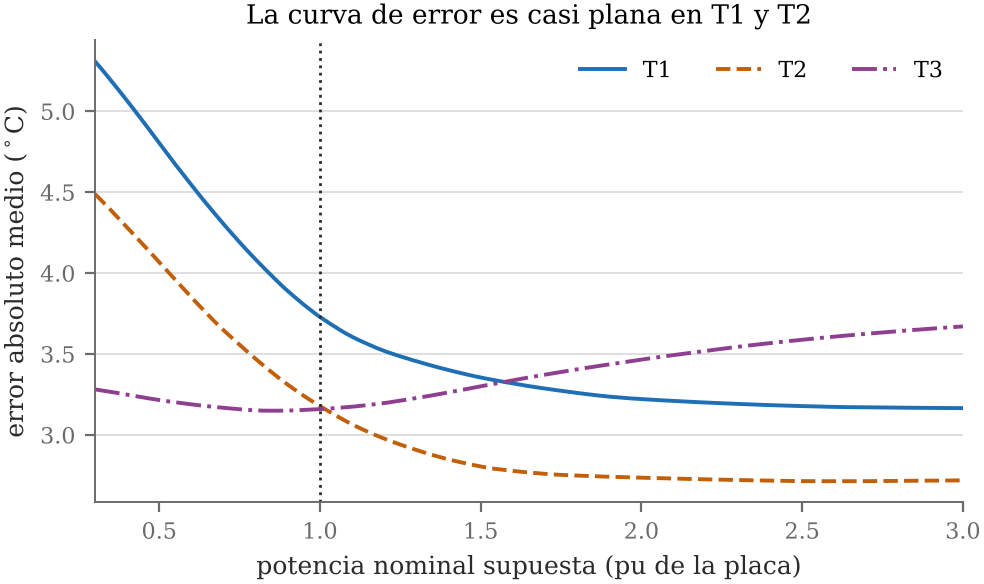

*Error del ajuste según la potencia nominal supuesta. T3 tiene un mínimo
definido cerca de la placa (línea de puntos); en T1 y T2 la curva desciende
hasta el borde de la rejilla.*

### Capacidad predictiva fuera de muestra

MAE en °C, validación cruzada dejando un mes fuera.

| Transformador | Normativo con la placa (1 par.) | Normativo libre (2 par.) | Lineal (2 par.) | Elevación constante (1 par.) | Mejora sobre la constante | Validación temporal: normativo / lineal |
|---|---|---|---|---|---|---|
| T1 | 3,79 | 3,20 | 3,24 | 3,22 | −17,7 % | 4,78 / 3,53 |
| T2 | 3,22 | 2,75 | 2,75 | 2,80 | −15,0 % | 3,72 / 2,97 |
| T3 | 3,27 | 3,28 | 3,28 | 4,14 | +21,2 % | 2,89 / 3,01 |

En T3 el modelo normativo con un solo parámetro predice un 21,2 % mejor que la
elevación constante, iguala al ajuste lineal de dos parámetros en la
validación cruzada y lo supera en la temporal. En T1 y T2 no mejora la línea
base.

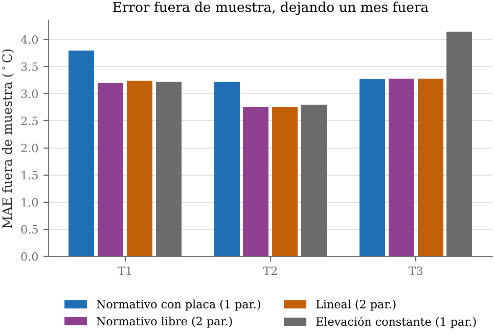

### El registro de ambiente

Los residuos del modelo en T1 y T2 caen con la temperatura ambiente con
pendiente cercana a −1; en T3 son planos.

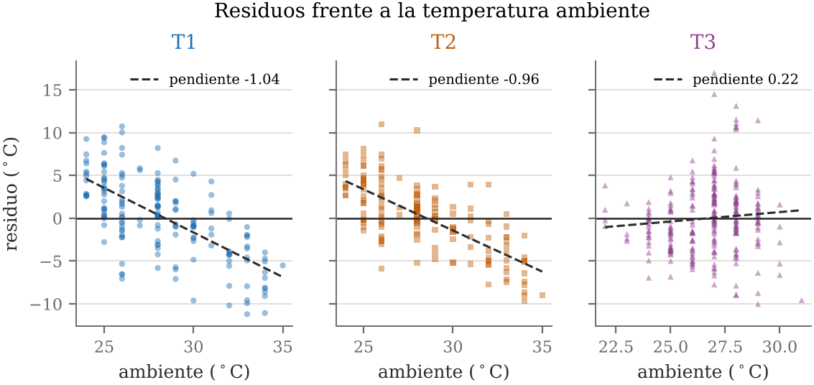

La temperatura ambiente entra en el modelo sumada con coeficiente fijo igual a
uno. Un error de medida en una variable de coeficiente fijo no se atenúa en el
ajuste: pasa entero al residuo, y produce una pendiente negativa. Una
pendiente próxima a −1 indica que el registro de ambiente apenas contiene
información sobre las condiciones que determinan el máximo diario del aceite.

Dos comprobaciones precisan el diagnóstico de S1:

| | T1 | T2 | T3 |
|---|---|---|---|
| Coeficiente del ambiente, con el máximo diario del aceite (la norma supone 1) | 0,08 | 0,13 | 1,23 |
| Coeficiente del ambiente, con la lectura de ronda del aceite | 0,62 | 0,49 | 1,20 |

Con la lectura de ronda, que el operador toma en el mismo recorrido que el
ambiente, el registro de S1 sí explica una parte del aceite. Es una lectura
puntual: acompaña a la lectura tomada en el mismo momento, pero no representa
las condiciones del día que fijan el máximo.

El defecto está en el registro, no en las máquinas. Descontada la carga y el
ambiente registrado, lo que queda del aceite de T1 y de T2 sube y baja a la
par (correlación 0,68 en 163 días). Promediada por meses, esa parte común
sigue al ambiente registrado en S2 (0,81) y apenas al de la propia S1 (0,29),
sobre 19 meses. Las máquinas de S1 responden al clima; su registro de ambiente
no lo recoge.

### Experimento de identificabilidad

Para separar el efecto del recorrido de carga del efecto del error en el
ambiente, se generan series con parámetros conocidos ($S_R = 1$,
$\Delta\theta_R = 55$ °C, 200 días cada una) y se intenta recuperarlos con el
mismo procedimiento. Se combinan seis recorridos de carga, entre 0,10 y
0,80 pu, con siete niveles de error del ambiente, entre 0 y 8 °C, con 200
repeticiones por combinación.

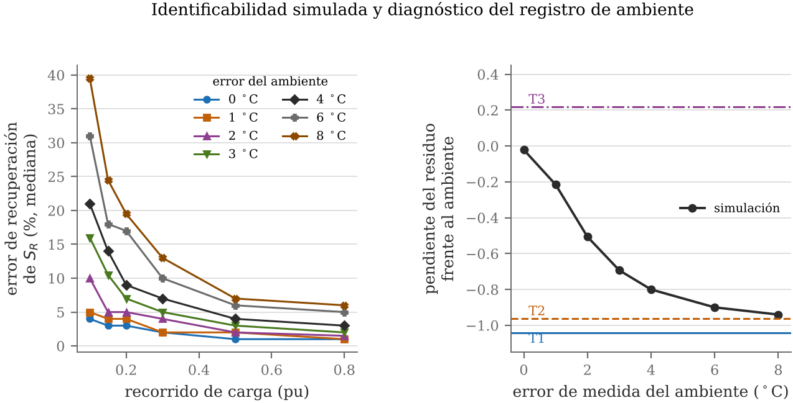

Con un recorrido de 0,15 pu y el ambiente bien medido, la potencia se recupera
con un error mediano del 3 %. Con el mismo recorrido y 8 °C de error en el
ambiente, el error mediano sube al 24,5 % y el percentil 90 al 72 %. El
recorrido estrecho, por sí solo, no impide la identificación; el factor
dominante es el error del ambiente.

La pendiente del residuo resulta estar en correspondencia casi biunívoca con
ese error:

| Error del ambiente (°C) | 0 | 1 | 2 | 4 | 8 |
|---|---|---|---|---|---|
| Pendiente del residuo | −0,02 | −0,21 | −0,51 | −0,80 | −0,94 |

Las pendientes observadas, −1,04 en T1, −0,96 en T2 y +0,22 en T3, sitúan el
registro de ambiente de S1 en el extremo de mayor error y el de S2 en el de
menor.

### Envejecimiento del aislamiento

| Transformador | Días equivalentes de vida consumidos por año |
|---|---|
| T1 | 0,68 |
| T2 | 0,57 |
| T3 | 0,85 |

Los valores de T1 y T2 se dan solo como referencia: la lectura del bobinado
de S1 aparece más fría que la del aceite en una parte de los días, lo que no
es físicamente posible en régimen permanente y resta fiabilidad al cálculo.

### Otros indicadores de condición

| Transformador | Máximo − ronda, mediana (°C) | Bobinado − aceite, mediana (°C) | Días con bobinado más frío que el aceite | Deriva del residuo (°C/mes) | Maniobras del cambiador por año |
|---|---|---|---|---|---|
| T1 | 2,0 | 0,0 | 44 (25 %) | −0,26 | 48 |
| T2 | 2,0 | 2,0 | 33 (20 %) | −0,16 | 49 |
| T3 | 2,0 | 12,0 | 5 (2 %) | −0,10 | 444 |

El bobinado no puede estar más frío que el aceite en régimen permanente. Que
lo esté en una cuarta parte de los días en T1 y en una quinta parte en T2
indica que la lectura de bobinado de S1 no es utilizable. El origen más
probable no es un sensor descalibrado: en T1 esa lectura coincide al grado con
la del aceite en el 58 % de los días, patrón que describe una celda copiada de
la contigua.

La deriva del residuo pide una advertencia. Más de la mitad de la
deriva acumulada en T1 procede del aumento de carga entre los dos tramos del
periodo combinado con un calentamiento nominal sobrestimado, y no de un cambio
en la máquina. Las medias mensuales están además autocorrelacionadas, de modo
que los cocientes t están inflados. El programa detecta la deriva; su magnitud
no debe tomarse al pie de la letra.

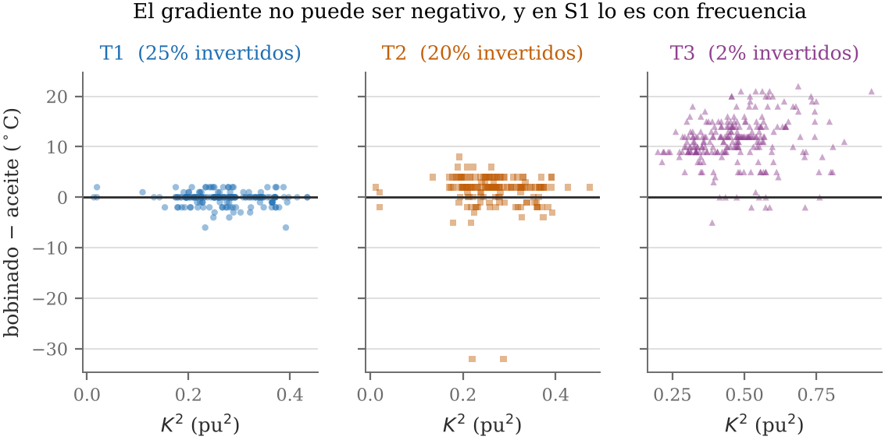

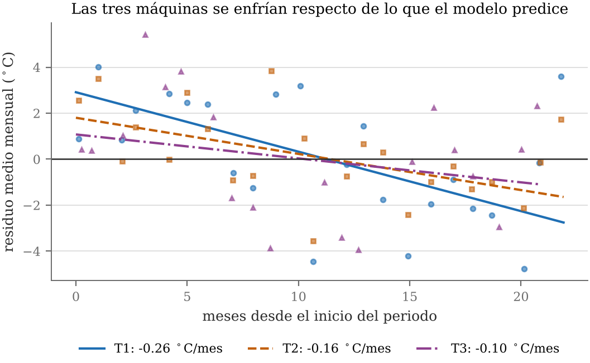

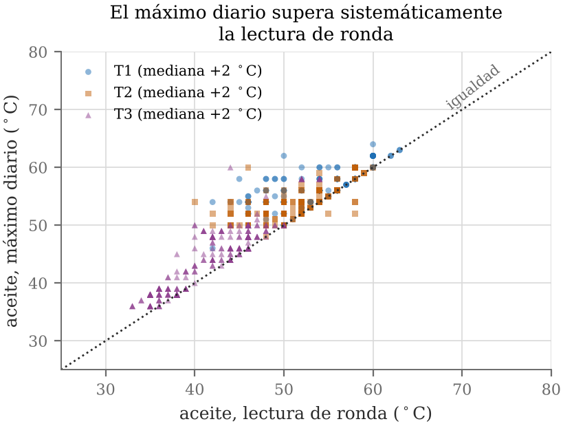

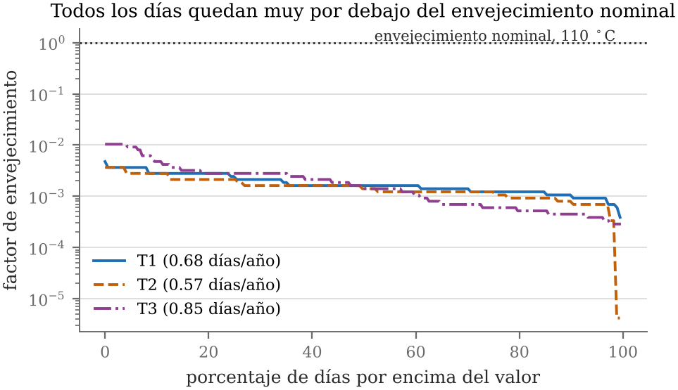

En los gases disueltos de T1, el acetileno no se detectó en ninguna de sus
246 lecturas: 219 marcan el límite inferior de detección y las 27 restantes
son cero.

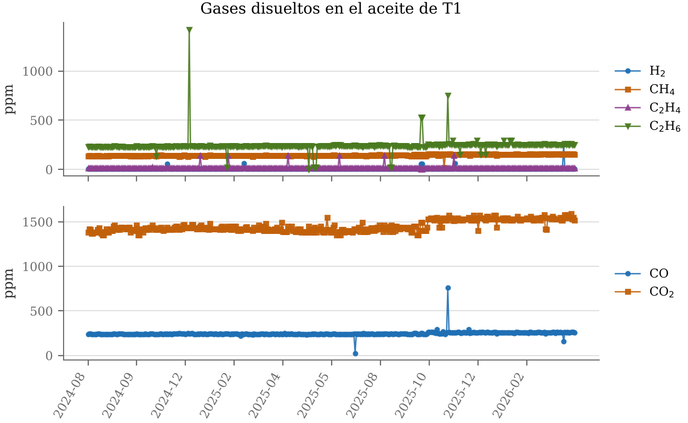

### Los datos

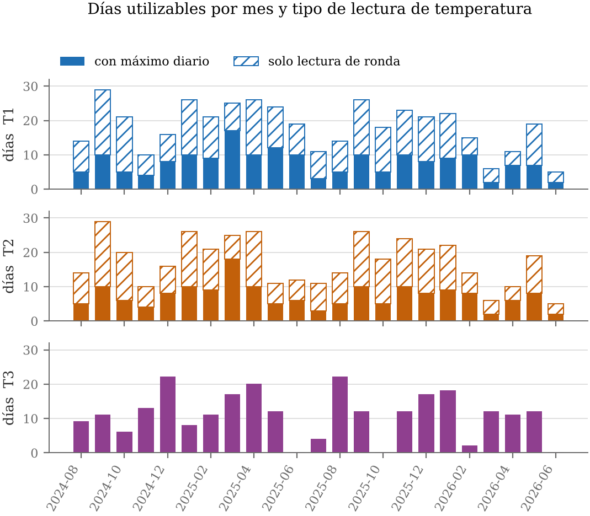

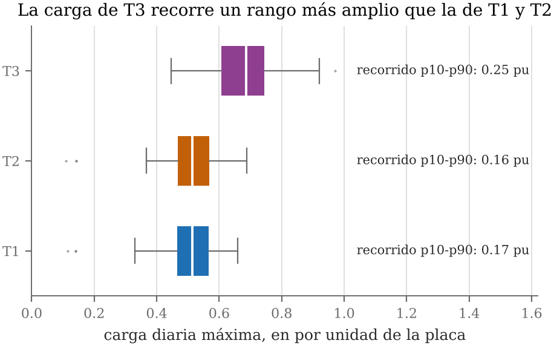

## Conclusión

El modelo térmico normativo puede identificarse a partir de registros
manuales de rutina cuando el registro de temperatura ambiente es fiable. En
ese caso, con un único parámetro libre, predice fuera de muestra mejor que una
elevación constante y al nivel de un ajuste lineal de dos parámetros. Cuando
el registro de ambiente tiene un error grande, la identificación no es
posible, y la pendiente del residuo frente al ambiente permite detectarlo con
los propios datos, sin un sensor de referencia.

## Ejecución

Python 3.13 o posterior.

```bash
pip install -r requirements.txt
python analisis_TFM.py
```

Sin argumentos, el programa lee `datos/` y escribe en `salida/`, ambas junto
al propio programa. También admite las dos carpetas de forma explícita:

```bash
python analisis_TFM.py <carpeta_datos> <carpeta_salida>
```

La ejecución tarda uno o dos minutos, casi todos en el experimento de
identificabilidad. Produce `resultados.json`, `sintetico.json`,
`condicion.json` y doce figuras, en PDF y PNG, e imprime un resumen en
pantalla. Las carpetas `figuras/` y `resultados/` de este repositorio
contienen esa misma salida.

## Alcance

El programa reproduce todas las cifras, tablas y figuras de la memoria que se
derivan de los datos publicados. Quedan fuera tres elementos que requieren los
formularios de origen, que no se publican: la auditoría de los formularios,
el perfil horario de carga y la comparación entre las dos fuentes de
temperatura ambiente, en S2 y en S1.

## Contenido

```
analisis_TFM.py    programa del análisis
datos/             conjuntos de datos anonimizados
figuras/           figuras generadas por el programa
resultados/        resultados generados por el programa
referencias/       bibliografía de la memoria, en BibTeX y RIS
requirements.txt   dependencias
LICENSE            licencia
```

## Referencias

`referencias/referencias.bib` y `referencias/referencias.ris` contienen las
veinte referencias bibliográficas citadas en la memoria, en dos formatos
que importan los gestores bibliográficos habituales, como Mendeley o Zotero.

## Licencia

Todos los derechos reservados. Véase el archivo `LICENSE`.
